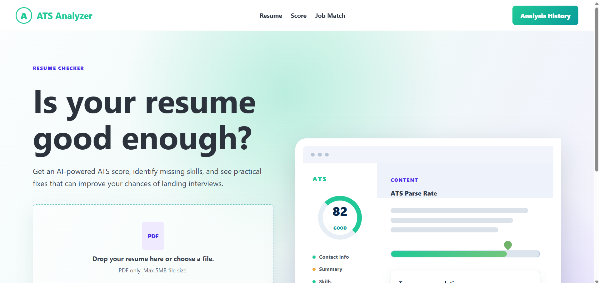
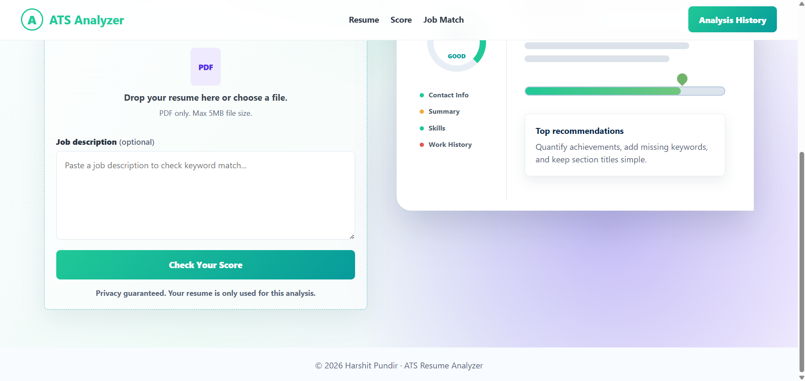
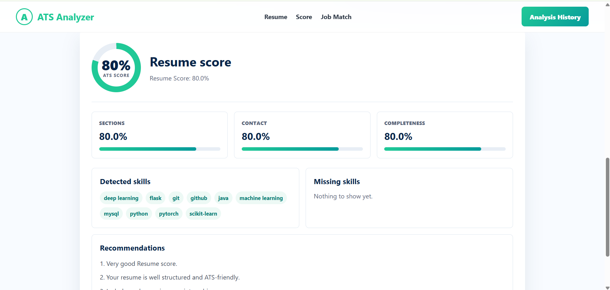
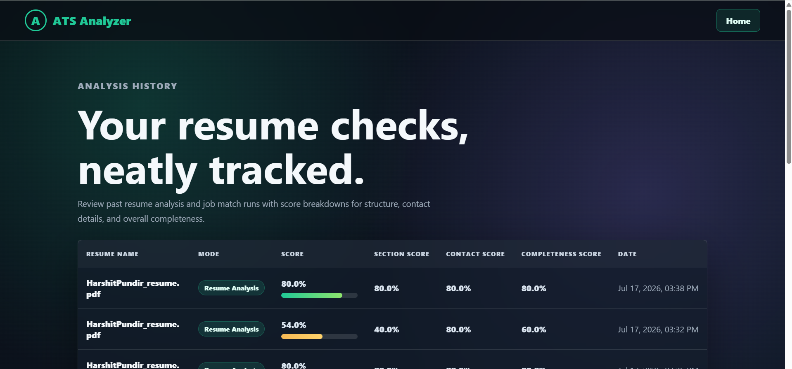

 <div align="center">

# 🚀 ResumePilot AI

### *Analyze. Improve. Get Shortlisted.*

An **NLP-powered Resume ATS Analyzer** that evaluates resumes, compares them with Job Descriptions, detects missing skills, and provides actionable feedback to improve ATS compatibility.

<p align="center">
  <a href="https://resumepilot-ai-gr6u.onrender.com/">
    
  </a>
</p>


<p align="center">
<strong>Most resumes are rejected before a recruiter even reads them.</strong><br>
This project helps you understand <strong>why</strong> and shows you <strong>how to improve.</strong>
</p>

</div>

---

# 📖 Overview

Applicant Tracking Systems (ATS) automatically scan resumes before they reach recruiters. A well-written resume can still be rejected if it lacks the right structure or keywords.

**ResumePilot AI** helps job seekers evaluate their resumes by analyzing important sections, extracting technical skills, comparing resumes with job descriptions, and generating detailed ATS scores with personalized recommendations.

Whether you're applying for internships or full-time software engineering roles, this tool provides practical insights to improve your resume.

---

# 🌟 Project Highlights

- 📄 PDF Resume Parsing with PyPDF2
- 🧠 NLP-powered Skill Extraction using spaCy
- 🎯 ATS Resume & Job Description Matching
- 📊 Multi-factor ATS Scoring System
- 🗄️ Resume Analysis History with Supabase
- ⚡ FastAPI-powered Backend
- 🎨 Responsive Web Interface

# ✨ Features

## 📄 Resume Analysis

- 📑 Extract text from PDF resumes
- 📂 Detect resume sections automatically
- 📞 Extract contact information
- 🛠️ Extract technical skills using NLP
- 📊 Calculate resume completeness score
- 💡 Generate personalized ATS recommendations

---

## 🎯 ATS Job Match

Compare your resume against any Job Description.

- ✅ Match technical skills
- ✅ Detect missing keywords
- ✅ Calculate ATS Job Match Score
- ✅ Highlight improvement areas
- ✅ Improve ATS compatibility

---

## 🗄️ Analysis History

Every resume analysis is automatically stored in Supabase.

- 📜 View previous resume analyses
- 📊 Track ATS scores over time
- 🕒 Analysis timestamp
- 📁 Separate Resume Analysis & Job Match history
- ⚡ Interactive history dashboard

---

## 📊 Detailed ATS Score

| Score | Description |
|---|---|
| 🎯 Overall Score | Final Resume / ATS Score |
| 💻 Skill Match | Resume vs Job Description |
| 📂 Section Score | Skills, Projects, Education & Experience |
| 📞 Contact Score | Email, Phone, GitHub & LinkedIn |
| 📋 Completeness Score | Overall Resume Quality |

---

# 🧠 How It Works

```text
                  Resume (PDF)
                       |
                       ▼
             PDF Text Extraction
                  (PyPDF2)
                       |
                       ▼
              Resume Text Processing
                       |
       ┌───────────────┼───────────────┐
       ▼               ▼               ▼
Resume Sections   Contact Details   Skill Extraction
       |               |               |
       └───────────────┼───────────────┘
                       ▼
                ATS Scoring Engine
                       |
           ┌───────────┴────────────┐
           ▼                        ▼
    Resume Analysis           Job Match
           |                        |
           └───────────┬────────────┘
                       ▼
         Save Analysis History
                  (Supabase)
                       |
                       ▼
           Interactive Dashboard
```

---

# 🏗️ Tech Stack

| Category | Technology |
|---|---|
| Backend | Python, FastAPI |
| NLP | spaCy |
| PDF Parsing | PyPDF2 |
| Database | Supabase (PostgreSQL) |
| Frontend | HTML5, CSS3, Vanilla JavaScript |
| API Documentation | FastAPI, Swagger UI |
| Version Control | Git & GitHub |

---

# 📂 Project Structure

```text
ATS checker/
├── main.py
├── config.py
├── deps.py
├── extensions.py
├── routes/
│   ├── __init__.py
│   ├── auth.py
│   ├── ai.py
│   ├── history.py
│   ├── home.py
│   ├── report.py
│   ├── security.py
│   └── upload.py
├── services/
│   ├── __init__.py
│   ├── ai_service.py
│   ├── contact_service.py
│   ├── feedback_service.py
│   ├── pdf_parser.py
│   ├── pdf_report_service.py
│   ├── scoring_service.py
│   ├── section_extractor.py
│   └── skills_service.py
├── static/
│   ├── css/
│   └── js/
├── templates/
├── tests/
├── utils/
│   ├── constants.py
│   └── logger.py
├── skills.json
├── requirements.txt
└── runtime.txt
```

---

# ⚙️ Installation

## 1️⃣ Clone Repository

```bash
git clone https://github.com/Harshit-pundir/ResumePilot-AI.git
cd ResumePilot-AI
```

---

## 2️⃣ Create Virtual Environment

### Windows

```bash
python -m venv venv
venv\Scripts\activate
```

### Linux / macOS

```bash
python3 -m venv venv
source venv/bin/activate
```

---

## 3️⃣ Install Dependencies

```bash
pip install -r requirements.txt
```

### OCR for scanned PDFs

Selectable-text PDFs continue to use the fast PyPDF2 parser. If a PDF has no
usable text layer, ResumePilot renders every page with PyMuPDF and reads the
images with `pytesseract`. The Python packages are installed by
`requirements.txt`; the Tesseract OCR application must also be installed on the
machine running the app.

**Windows:** Install Tesseract OCR (for example, using the UB Mannheim Windows
installer). ResumePilot detects Tesseract on `PATH` and in common Windows
install locations, including `C:\Program Files\Tesseract-OCR\tesseract.exe`.
To use another installation, set `TESSERACT_CMD` in `.env`, for example:

```env
TESSERACT_CMD=C:\Program Files\Tesseract-OCR\tesseract.exe
```

**Ubuntu/Debian:**

```bash
sudo apt-get update && sudo apt-get install -y tesseract-ocr
```

**macOS (Homebrew):**

```bash
brew install tesseract
```

OCR runs only when selectable text is empty or below the parser's minimum
threshold. If neither extraction method produces readable text, upload returns
an error rather than scoring an empty resume.

### Render deployment

The Tesseract engine is an operating-system package and is not installed by
`pip install pytesseract`. For Render, use the included `Dockerfile` so the
runtime image installs both `tesseract-ocr` and English OCR data. In the Render
service settings, change the service runtime to **Docker** and deploy the
repository's Dockerfile. Keep your existing Supabase, Groq, and JWT environment
variables in the Render dashboard. `TESSERACT_CMD` is optional in this image
because Tesseract is installed on `PATH`; set it only if you use a custom
binary path.

---

## 4️⃣ Download spaCy Model

```bash
python -m spacy download en_core_web_sm
```

---

## 5️⃣ Configure Environment Variables

Create a `.env` file in the project root.

```env
SUPABASE_URL=https://your-project.supabase.co
SUPABASE_KEY=your_supabase_key
GROQ_API_KEY=your_groq_api_key
JWT_SECRET_KEY=replace_with_a_long_random_secret
COOKIE_SECURE=false
```

**Important:** Never commit your `.env` file or expose your Supabase secret key publicly.
Set `COOKIE_SECURE=true` when serving the site over HTTPS (including Render).

---

## 6️⃣ Run the Application

Start the FastAPI server using Uvicorn:

```bash
uvicorn main:app --reload
```

Open your browser:

```text
http://127.0.0.1:8000
```

### 📚 API Documentation

FastAPI automatically generates interactive API documentation.

- **Swagger UI:** http://127.0.0.1:8000/docs
- **ReDoc:** http://127.0.0.1:8000/redoc

---

# 📸 Screenshots

## 🏠 Landing Page





---

## 📊 ATS Result Dashboard



---

## 🗄️ Analysis History



---

# 🚀 Roadmap

- [ ] Download ATS Report as PDF
- [x] Resume Analysis History
- [ ] Resume Comparison
- [ ] AI Resume Suggestions
- [x] Dark Mode
- [x] Live Deployment
- [x] Migrate Backend from Flask to FastAPI

---

# 🤝 Contributing

Contributions are welcome!

1. Fork the repository.
2. Create a new branch.
3. Commit your changes.
4. Open a Pull Request.

---

# 👨‍💻 About the Developer

## Harshit Pundir

B.Tech CSE Student • Quantum University

Passionate about Backend Development, AI/ML, and building impactful software solutions.

### 🌐 Connect with Me

- **GitHub** — https://github.com/Harshit-pundir
- **LinkedIn** — https://www.linkedin.com/in/harshit-pundir-a5b112332/
- **LeetCode** — https://leetcode.com/Harshitpundir
- 📧 **Email** — harshitpundir36@gmail.com

---

<div align="center">

## ⭐ Support the Project

If you found this project useful, please consider giving it a **Star ⭐** on GitHub.

**Made with ❤️ by Harshit Pundir**

</div>
